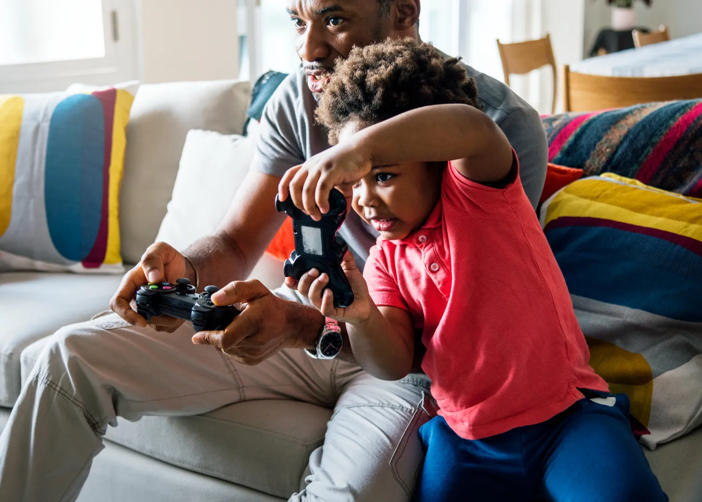

*Photo: Designed by Magnific [www.magnific.com][4]*

## Concrètement, qu’est-ce qu’une “utilisation saine” des jeux vidéo ?

Le jeu vidéo est aujourd’hui un objet culturel central qui peut favoriser la créativité et la résolution de problèmes[^1]. 
Pour que cette pratique reste bénéfique, quelques habitudes simples sont à mettre en place pour toute la famille.

## 1. Limitez le temps d'écran

Une introduction progressive est essentielle pour protéger le développement de l'enfant. Jusqu'à 3 ans (et idéalement 4 ans), 
il est fortement recommandé d'éviter toute exposition aux écrans, car **les interactions avec le monde réel en trois dimensions 
sont vitales** pour le développement du langage et de la motricité.[^2][^3][^4]

À partir de 4 ans, le jeu vidéo peut être introduit de manière très limitée et occasionnelle, toujours sous l'encadrement 
d'un adulte et sans dépasser une heure consécutive[^2][^4].
Plutôt que de fixer un "temps quotidien" qui ritualise la pratique, privilégiez une logique hebdomadaire (par exemple, 
uniquement le week-end) pour éviter l'installation d'une routine quotidienne[^2]. 
Enfin, **préservez absolument le sommeil** en interdisant les écrans dans l'heure précédant le coucher, la lumière bleue et 
l'excitation perturbant les rythmes biologiques[^2].

N'oubliez pas que **votre enfant vous imite** : le respect de ces règles sera bien plus simple si vous faites preuve d'exemplarité en posant vous-même votre smartphone lors des repas et des moments partagés[^2][^4].

## 2. Veillez à la disponibilité d'activités alternatives

Le jeu vidéo ne doit pas devenir une "valeur refuge" par défaut[^2].L’enfant apprend et s'épanouit davantage par l'interaction 
humaine et physique que par un écran[^3].

Favorisez les activités qui sollicitent tous les sens :
- Le **jeu libre** et les jeux de construction pour développer l'autonomie[^2]
- Les **activités en plein air** : au moins 2 heures par jour à l'extérieur sont nécessaires pour contrer le développement 
de la myopie, un risque aggravé par l'utilisation prolongée d'écrans proches des yeux[^2]
- La **lecture à voix haute** ou les boîtes à histoires pour soutenir l'imaginaire[^2]

## 3. Utilisez le jeu comme un outil d'échange

Le jeu vidéo n'est pas une activité isolée mais un média social : en France, **81 % des jeunes joueurs** pratiquent leur 
passion avec d'autres personnes[^4][^5].Pour soutenir la croissance cognitive et émotionnelle de votre enfant, transformez 
le jeu en sujet de discussion :
- **L'histoire** : Quels sont les personnages ? Quelles émotions ressent-il face à leurs aventures ?
- **Les règles** : Comment va-t-il résoudre tel problème ? Quelles sont les contraintes du jeu ?
- **La complicité** : Jouer ensemble occasionnellement permet de mieux accompagner l'enfant face à des contenus inadaptés 
et de renforcer les liens familiaux[^4]

## Pour aller plus loin

Pour vous aider à choisir les bons contenus, référez-vous systématiquement à la **classification PEGI**, qui indique l'âge 
recommandé et la nature des contenus (violence, microtransactions, etc.). Vous pouvez également consulter :
- Le site « [Mon enfant et les écrans][2] » (UNAF)
- Le site « [Je protège mon enfant][3] » pour des conseils sur le contrôle parental

[^1]: Piki & Co (2026) [Le jeu, un vecteur d'apprentissage puissant][1]
[^2]: Commission d'experts. (2024). _Enfants et écrans : À la recherche du temps perdu._ Rapport remis à la Présidence de la République française.
[^3]: Société Française de Pédiatrie, Société Française d’Ophtalmologie, et al. (2025). _Les activités sur écrans ne conviennent pas aux enfants de moins de 6 ans._ Tribune collective.
[^4]: Rufat, S., Ter Minassian, H., & Coavoux, S. (2014). Jouer aux jeux vidéo en France : Géographie sociale d’une pratique culturelle. _L’Espace géographique_, 43(4), 308-323.
[^5]: Tisseron, S. (2008). _La règle 3-6-9-12._ (Recommandation citée et analysée dans le rapport de la Commission d'experts, 2024).

[1]:/blog/learningwithgames/
[2]:https://www.mon-enfant-et-les-ecrans.fr/
[3]:https://jeprotegemonenfant.gouv.fr/ecrans/
[4]:https://www.magnific.com
