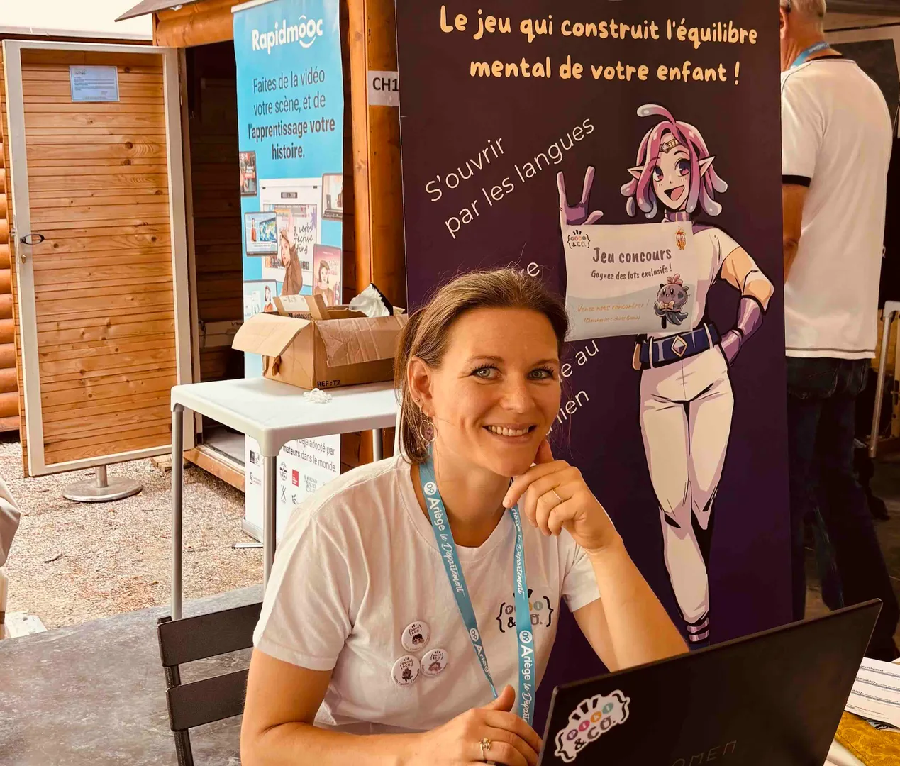

*Photo : Olivier Luet*

C'est par le train qu'une partie de l'équipe de Piki & Co s'est rendue à Ax-Les-Thermes en Ariège pour participer aux universités d'été de Ludovia. 
3 jours pour rencontrer et échanger avec tous les acteurs du monde de l'éducation : Les enseignants en 1er lieu, les académies et régions et les éditeurs. 
Tous réunis autour d'une même envie : Proposer des outils et solutions pertinentes pour les apprenants et simples et utiles pour les enseignants. 

## Pourquoi participer à Ludovia ?
Participer aux [Universités d’été de Ludovia][1] à Ax-les-Thermes s’inscrit comme une étape stratégique et nécessaire pour notre démarche éducative. 
Suite à notre participation au [FLIP][2] et aux rencontres précieuses avec des familles et des parents, il nous est apparu aujourd’hui essentiel de prolonger cet élan au cœur de la communauté éducative professionnelle.

## Rencontrer les enseignants
Cet événement nous a offert une opportunité unique de rencontrer, d’échanger et de présenter notre prototype directement aux enseignants du premier degré. 
Ces professionnels sont en première ligne dans l’apprentissage des compétences psychosociales, ces compétences humaines et cognitives fondamentales qui structurent l’enfant. 
Leurs retours d’expérience sont indispensables pour valider et améliorer nos outils avant leur déploiement à grande échelle.

## Retours positifs ! 
Les enseignants avec lesquels nous avons échangé ont tous été enthousiastes tant sur le fond (narration, scénario d'éveil aux langues, etc.) que sur la forme (jeu sur tablette, cahier d'accompagnement, jeu de plateau ou jeu de carte). 
Un grand merci pour leurs retours qui nous donnent de l'énergie et nous permettre d'avancer et d'enrichir notre jeu Ki-tämi ! 

## Rencontrer les éditeurs scolaires et acteur des EdTech
Au-delà du monde de l’enseignement, Ludovia constitue un carrefour incontournable pour les éditeurs scolaires et les acteurs de l’EdTech. 
C’est l’occasion privilégiée d’échanger entre professionnels, de confronter nos visions et d’imaginer des collaborations fructueuses qui pourront enrichir 
l’offre éducative numérique.

Enfin, cet événement marquera l’annonce officielle de l’arrivée prochaine du premier jeu immersif multisupport dédié à l’apprentissage de l'anglais. 
Une innovation qui s’inscrit dans la continuité de notre engagement pour des outils d’apprentissage engageants et accessibles à tous.

[1]: https://www.ludovia.fr
[2]: https://www.jeux-festival.com/
